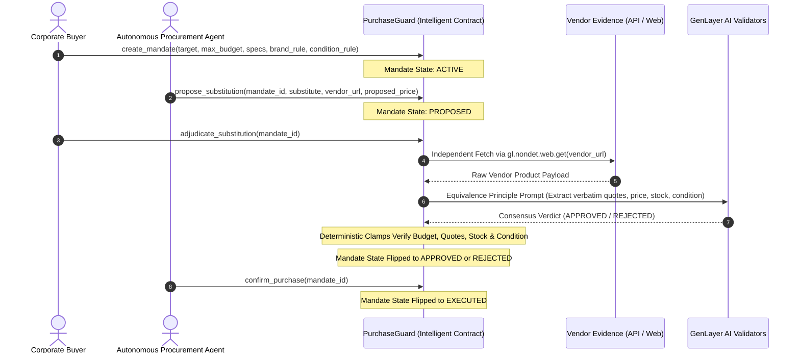

# PurchaseGuard — Autonomous On-Chain Procurement Firewall

> **GenLayer Builder Track**: Intelligent Contracts  
> **Network**: GenLayer StudioNet (Chain ID: `61999`)  
> **Runtime**: `py-genlayer:1jb45aa8ynh2a9c9xn3b7qqh8sm5q93hwfp7jqmwsfhh8jpz09h6`  
> **Deployed Contract (StudioNet)**: [`0x2A835e048362A8A38bD4F4Ef0d4b83F96D2c410a`](https://explorer-studio.genlayer.com/address/0x2A835e048362A8A38bD4F4Ef0d4b83F96D2c410a)

An autonomous on-chain procurement firewall and policy escrow primitive built on GenLayer. `PurchaseGuard` protects corporate procurement and autonomous shopping agents from hallucinations, hidden price surges, counterfeit goods, and deceptive product substitutions.

Unlike contracts that trust caller-supplied arguments, `PurchaseGuard` **independently acquires and validates material vendor facts on-chain** using `gl.nondet.web.get()`, extracts mandatory verbatim quote evidence under the Equivalence Principle (`gl.eq_principle.prompt_non_comparative`), and enforces deterministic safety clamps.

---

## 1. Architecture & Verification Flow



---

## 2. Live On-Chain Deployments & Verified StudioNet Manifest

All transactions below were executed and reached finality on StudioNet:

| Step | Method | Tx Hash | Result & Consensus State |
| :---: | :--- | :--- | :--- |
| **1** | `deploy` | [`0xcf3f4b3dcf...`](https://explorer-studio.genlayer.com/tx/0xcf3f4b3dcf0d9e4f1fb394a4d9c1de53f91a1a2c34ae7fd18e3f8482e73f103c) | **FINALIZED** (Contract deployed at `0x2A83...410a`) |
| **2** | `create_mandate` (Mandate 1) | [`0xfcdc48c5d7...`](https://explorer-studio.genlayer.com/tx/0xfcdc48c5d70a0433c68383e85bedcc4d3fc340305f17cb329a8173dd0d288c3b) | **FINALIZED** (Target: 1TB NVMe, read >= 7000MB/s) |
| **3** | `propose_substitution` (Mandate 1) | [`0xd4d9041af2...`](https://explorer-studio.genlayer.com/tx/0xd4d9041af2a8895b3418c9b552d17deed96e75eeb445bc7254721296dbd0b122) | **FINALIZED** (Crucial P5 Plus proposed) |
| **4** | `adjudicate_substitution` (Mandate 1) | [`0x2fdcfd4269...`](https://explorer-studio.genlayer.com/tx/0x2fdcfd4269a469fd62e59abb905b0b97ef33291789256174f8a9da6eb635799a) | **FINALIZED**: `REJECTED`<br>Caught read speed 6600MB/s < 7000MB/s floor<br>Quote: `"sequential_read_speed": "6600 MB/s"` |
| **5** | `create_mandate` (Mandate 2) | [`0xa5568b6da9...`](https://explorer-studio.genlayer.com/tx/0xa5568b6da9656c2041576f1a540262c64bd4ae05cc534475e3c3275cabc9a3bc) | **FINALIZED** (Target: 1TB NVMe, NEW_ONLY) |
| **6** | `propose_substitution` (Mandate 2) | [`0xfcb26f1652...`](https://explorer-studio.genlayer.com/tx/0xfcb26f1652dd5595f1a78ae2079518ea8a6685b5feee2b55ac55510f0e0599e4) | **FINALIZED** (Adversarial proposal: Refurbished SATA) |
| **7** | `adjudicate_substitution` (Mandate 2) | [`0xb44029811b...`](https://explorer-studio.genlayer.com/tx/0xb44029811bf94cf428ee7866488097d63c9d1884897bf03c649dafe5e4bf0cd9) | **FINALIZED**: `REJECTED`<br>**Abuse Intercepted**: Caught REFURBISHED condition & SATA downgrade<br>Quote: `"condition": "REFURBISHED"` |
| **8** | `create_mandate` (Mandate 3) | [`0xa20d92cf86...`](https://explorer-studio.genlayer.com/tx/0xa20d92cf8627e33012e567bb1bfac04ae0c55d67f161f6d5096b3532fc137221) | **FINALIZED** (Target: 1TB NVMe, read >= 6500MB/s, ANY brand) |
| **9** | `propose_substitution` (Mandate 3) | [`0x110652f02d...`](https://explorer-studio.genlayer.com/tx/0x110652f02d33cfcb064206902085b83ad526915054e14c59b9b0b8900783276d) | **FINALIZED** (Crucial P5 Plus proposed) |
| **10** | `adjudicate_substitution` (Mandate 3) | [`0x80cee7727d...`](https://explorer-studio.genlayer.com/tx/0x80cee7727db2bdeb7153fbbca75ee93688d61960d5fca8c4b9318ae101d18805) | **FINALIZED**: `APPROVED`<br>Independent fetch verified 6600MB/s >= 6500MB/s, $89.99 < $100 budget |
| **11** | `confirm_purchase` (Mandate 3) | [`0x1f5a84f3fa...`](https://explorer-studio.genlayer.com/tx/0x1f5a84f3fa1529153b749d14e3c02f589ee5d12afecb53d156a440de158b6422) | **ACCEPTED**: State transitioned to `EXECUTED` |

Full transaction parameters and read-back states are documented in [`deploy/proof.json`](file:///C:/Users/user/Desktop/genlayer-purchase-guard/deploy/proof.json).

---

## 3. Four Deterministic Safety Clamps

1. **Independent Evidence Acquisition**: Contract fetches evidence directly using `gl.nondet.web.get()`. Never relies on caller-supplied specification parameters.
2. **Mandatory Verbatim Quoting**: AI validators must extract an exact substring from the fetched payload. If missing, contract clamps to `REJECTED`.
3. **Hard Budget Ceiling**: If vendor price exceeds `max_budget_cents`, contract forcefully clamps to `REJECTED`.
4. **Condition & Stock Invariants**: If the vendor payload shows `REFURBISHED` on a `NEW_ONLY` mandate or `OUT_OF_STOCK`, contract forcefully clamps to `REJECTED`.

---

## 4. Local Testing & Verification

```bash
uv run python -m unittest discover -s tests
```

Output:
```
.........
----------------------------------------------------------------------
Ran 9 tests in 0.001s

OK
```
