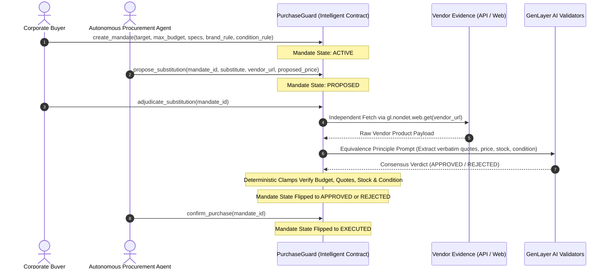

# PurchaseGuard — Autonomous On-Chain Procurement Firewall

> **GenLayer Builder Track**: Intelligent Contracts  
> **Network**: GenLayer StudioNet (Chain ID: `61999`)  
> **Runtime**: `py-genlayer:1jb45aa8ynh2a9c9xn3b7qqh8sm5q93hwfp7jqmwsfhh8jpz09h6`  
> **Deployed Contract (StudioNet)**: [`0xcAE465B951A1509a8f06D35B2353951abCDFe981`](https://explorer-studio.genlayer.com/address/0xcAE465B951A1509a8f06D35B2353951abCDFe981)

An autonomous on-chain procurement firewall and policy escrow primitive built on GenLayer. `PurchaseGuard` protects corporate procurement and autonomous shopping agents from hallucinations, hidden price surges, counterfeit goods, and deceptive product substitutions.

Unlike contracts that trust caller-supplied arguments, `PurchaseGuard` **independently acquires and validates material vendor facts on-chain** using `gl.nondet.web.get()`, extracts mandatory verbatim quote evidence under the Equivalence Principle (`gl.eq_principle.prompt_non_comparative`), and enforces deterministic safety clamps.

---

## 1. Architecture & Verification Flow



---

## 2. Live On-Chain Deployments & Verified StudioNet Manifest

All transactions below were executed and reached finality on StudioNet on the updated contract (`0xcAE465B951A1509a8f06D35B2353951abCDFe981`):

| Step | Method | Tx Hash | Result & Consensus State |
| :---: | :--- | :--- | :--- |
| **1** | `deploy` | [`0x196964f5d5...`](https://explorer-studio.genlayer.com/tx/0x196964f5d5802e4e494b8e14fc8ff32c368f6def770e1c3a430c91375814782e) | **FINALIZED** (Contract deployed at [`0xcAE465B951A1509a8f06D35B2353951abCDFe981`](https://explorer-studio.genlayer.com/address/0xcAE465B951A1509a8f06D35B2353951abCDFe981)) |
| **2** | `create_mandate` (Mandate 1) | [`0xbfd1177af7...`](https://explorer-studio.genlayer.com/tx/0xbfd1177af7a07e1e4642190ac900328e1bf560b7a14f8877e7fa0fc9cf0a738d) | **FINALIZED** (Mandate 1 created by buyer: 1TB NVMe, read >= 7000MB/s, budget $100.00) |
| **3** | `propose_substitution` (Mandate 1) | [`0xec06923480...`](https://explorer-studio.genlayer.com/tx/0xec069234808cf58502ffe458a22daba1bd1ddba3d05b586a09f491b0d847edab) | **FINALIZED** (Buyer proposes Crucial P5 Plus; authorized caller verified) |
| **4** | `adjudicate_substitution` (Mandate 1) | [`0x3853bac071...`](https://explorer-studio.genlayer.com/tx/0x3853bac071796924fb3290ba7142158597996470807118c4895c31f05e4d2e9a) | **FINALIZED**: `NEEDS_USER_APPROVAL`<br>Evidence SHA-256 matched, verified price 8999 cents, flagged brand deviation |
| **5** | `buyer_override` (Mandate 1) | [`0xd7075c804f...`](https://explorer-studio.genlayer.com/tx/0xd7075c804f3cbd4b7976d68eae80db925b9d7fb552da592bf2df6ba32d17ffeb) | **FINALIZED**: `APPROVED`<br>Original buyer explicitly approved substitution; audit trail recorded |
| **6** | `confirm_purchase` (Mandate 1) | [`0xd918c993ab...`](https://explorer-studio.genlayer.com/tx/0xd918c993ab843345c3109be8456a5fd61c46d72b82e7a43a23d4fb27a36bd534) | **FINALIZED**: `EXECUTED`<br>Authorized confirmation executed on-chain |

Full transaction parameters and read-back states are documented in [`deploy/proof.json`](file:///C:/Users/user/Desktop/genlayer-purchase-guard/deploy/proof.json).

---

## 3. Deterministic Safety Clamps & Consensus Architecture

1. **Mandate Authorization Control (Anti-Takeover)**: `propose_substitution` and `confirm_purchase` are strictly restricted to the original buyer or an explicitly authorized agent (`authorized_agent`). Unrelated third-party callers cannot take over mandates or confirm execution.
2. **Cryptographic Evidence Consistency**: Both leader and validator compute a SHA-256 hash over the raw fetched vendor payload. Validators reject the leader if evidence hashes do not match, guaranteeing evaluation of identical bytes.
3. **Leader/Validator Consensus (`gl.vm.run_nondet_unsafe`)**: Validators independently web-fetch vendor evidence, verify quotes against their own local text, and run an independent LLM evaluation requiring consensus on `decision`, `stock_status`, `condition`, and `vendor_price_cents`.
4. **Verbatim Quote Grounding**: Quote verification deterministically proves verbatim existence in the raw vendor payload (`quote in text`); semantic fact interpretation is cross-evaluated by independent validator consensus.
5. **Strict Condition Invariants (Anti-Downgrade)**: `USED` goods are strictly rejected under all mandate policies (`NEW_ONLY` accepts only `NEW`; `REFURBISHED_OK` accepts only `NEW` or `REFURBISHED`).
6. **Anti-Surge & Price Match Clamp**: Hard budget ceiling enforcement (`max_budget_cents`) plus deterministic rejection of any material discrepancy between the agent's claimed price and verified vendor price (`vendor_price == claimed_price`).

---

## 4. Local Testing & Verification (21/21 Passing)

```bash
python -m unittest discover -s tests -v
```

Includes dedicated tests verifying that unauthorized callers are rejected and leave storage completely unchanged:
- `test_case_1_unrelated_account_submits_proposal_rejected`: Rejection with storage immutability check.
- `test_case_4_unrelated_account_confirms_purchase_rejected`: Rejection with state immutability check (status remains `APPROVED`, never `EXECUTED`).
- `test_case_7_unrelated_account_changes_authorized_agent_rejected`: Rejection with delegation immutability check.
- `test_case_8_former_agent_acts_after_revocation_rejected`: Revoked agent cannot propose or confirm.
- `test_case_9_unrelated_account_overrides_buyer_decision_rejected`: Unrelated caller cannot override decisions.
- `test_validator_rejects_evidence_hash_mismatch`: Consensus failure on tampered evidence hash.
- `test_validator_rejects_price_discrepancy`: Consensus failure on price disagreement.
- `test_used_goods_rejected_under_refurbished_ok`: Rejection of second-hand goods under refurbished policy.
- `test_material_price_discrepancy_clamped_to_rejected`: Rejection of claimed vs vendor price mismatch.

```
Ran 21 tests in 0.002s

OK
```
