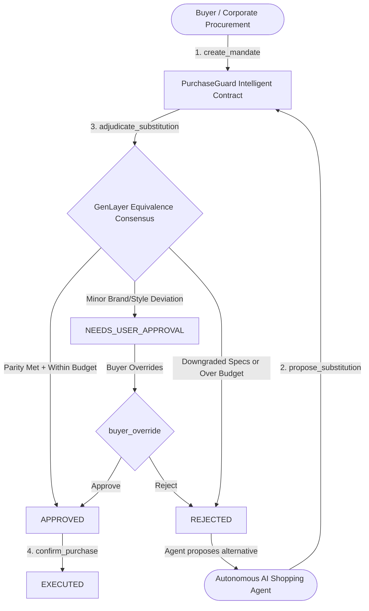

# PurchaseGuard — Agentic Purchase Substitution Guard

[](https://genlayer.com)
[](https://docs.genlayer.com)
[](tests/test_purchase_guard.py)
[](LICENSE)

An autonomous on-chain procurement firewall and policy escrow primitive built on GenLayer. `PurchaseGuard` enables AI shopping and procurement agents to handle out-of-stock events, price surges, and model discontinuations by adjudicating product substitutions through subjective multi-validator consensus under the GenLayer Equivalence Principle.

---

## The Problem in the Agentic Economy

Autonomous AI agents are increasingly entrusted with discretionary purchasing power—booking travel, purchasing inventory, acquiring compute instances, and ordering hardware. However, real-world commerce is non-deterministic:

1. **Inventory Volatility**: Target items frequently go out-of-stock or face unexpected price fluctuations.
2. **The EVM Limitation**: Traditional smart contracts (EVM/SVM) operate purely on rigid numeric equality or cryptographic hashes. They cannot judge whether a *Crucial P5 Plus 1TB NVMe SSD* is functionally and economically equivalent to an out-of-stock *Samsung 980 Pro 1TB NVMe SSD*.
3. **The Agent Dilemma**: Current agents either:
   - **Halt and stall** waiting for human approval, breaking automation workflows; or
   - **Hallucinate bad substitutes**, purchasing incompatible, downgraded, or over-budget products with zero on-chain accountability.

---

## The Solution: PurchaseGuard

`PurchaseGuard` introduces an autonomous on-chain arbiter that bridges buyer constraints with agent autonomy:



---

## Key Features

1. **Configurable Purchase Mandates**: Buyers define exact specification floors, budget ceilings in cents, brand rules (`STRICT`, `PREFERRED`, `ANY`), and condition rules (`NEW_ONLY`, `REFURBISHED_OK`).
2. **Evidence-Backed Substitution Proposals**: Agents submit substitute items with verifiable specification details, vendor URLs, and stock shortage rationale.
3. **Multi-Pillar Equivalence Adjudication**: GenLayer validators reach consensus using `gl.eq_principle.prompt_non_comparative` over 4 objective pillars:
   - **Budget Ceilings**: Strict economic compliance.
   - **Specification Parity**: Capacity, speed, form factor, and interfaces.
   - **Brand Compliance**: Strict enforcement vs. acceptable soft deviations.
   - **Condition Enforcement**: Strict factory-new guarantees.
4. **Deterministic Budget Clamp**: Even if an LLM returns a hallucinated approval, an on-chain deterministic guardrail (`proposed_price > max_budget`) forcefully clamps the result to `REJECTED`.
5. **Buyer Governance & Dispute Override**: Buyers retain sovereign control to approve or veto `NEEDS_USER_APPROVAL` decisions or cancel unfulfilled mandates.

---

## Contract State Machine

```
[ACTIVE] ──(propose_substitution)──> [PROPOSED]
                                          │
                                 (adjudicate_substitution)
                                          │
                  ┌───────────────────────┼───────────────────────┐
                  ▼                       ▼                       ▼
             [APPROVED]       [NEEDS_USER_APPROVAL]          [REJECTED]
                  │                       │                       │
          (confirm_purchase)        (buyer_override)         (re-propose)
                  │                       │                       │
                  ▼                       ▼                       ▼
             [EXECUTED]          [APPROVED] / [REJECTED]      [PROPOSED]
```

---

## Contract Methods Specification

### Write Methods

| Method | Parameters | Description |
| :--- | :--- | :--- |
| `create_mandate` | `target_item: str, max_budget_cents: int, required_specs: str, brand_rule: str, condition_rule: str` | Initializes a new purchase mandate and returns its `mandate_id` (`u256`). |
| `propose_substitution` | `mandate_id: int, substitute_item: str, proposed_price_cents: int, item_specs: str, reason_unavailable: str, vendor_url: str` | Agent submits a replacement product proposal for an active mandate. |
| `adjudicate_substitution` | `mandate_id: int` | Triggers GenLayer Equivalence Principle consensus across validators to evaluate equivalence. |
| `confirm_purchase` | `mandate_id: int` | Marks an `APPROVED` mandate as `EXECUTED` when the agent confirms transaction completion. |
| `buyer_override` | `mandate_id: int, approve: bool` | Allows the mandate creator to approve or reject a `NEEDS_USER_APPROVAL` proposal. |
| `cancel_mandate` | `mandate_id: int` | Cancels an unfulfilled mandate. Callable by the buyer or contract owner. |

### View Methods

| Method | Returns | Description |
| :--- | :--- | :--- |
| `get_mandate(mandate_id)` | `str` (JSON) | Retrieves the full buyer mandate record. |
| `get_proposal(mandate_id)` | `str` (JSON) | Retrieves the current agent proposal record. |
| `get_adjudication(mandate_id)` | `str` (JSON) | Retrieves the validator consensus result with score and rationale. |
| `get_mandate_status(mandate_id)` | `str` | Returns the current state string (`ACTIVE`, `PROPOSED`, `APPROVED`, etc.). |
| `get_total_mandates()` | `u256` | Returns total number of registered mandates. |
| `get_guard_stats()` | `str` | Summarizes contract owner address and total mandates. |

---

## Consensus Design & Rotation Safety

GenLayer contracts execute in an environment of heterogeneous AI validators. To guarantee unanimous consensus on **Rotation 0** without triggering validator divergence or `Undetermined` states:

1. **Objective, Positive Equivalence Criteria**: Criteria are framed constructively (`"If substitute matches or exceeds all required specifications within budget, decision is APPROVED"`), avoiding contradictory negative rules.
2. **Structured JSON Output**: Validators return a standardized JSON schema containing `decision`, `spec_score`, `price_compliance`, and `rationale`.
3. **Format Sanitization**: Built-in regex and bracket parsing cleanly sanitizes markdown code fences (` ```json `) emitted by diverse validator models.
4. **Deterministic Invariant Enforcement**: Critical invariants (such as budget overruns) are mathematically verified in code, ensuring zero economic risk regardless of model nuance.

---

## Local Verification & Testing

The repository contains an automated test suite verifying all state transitions, boundary validations, access controls, and safety clamps without external network dependencies.

### Run Tests:

```bash
python tests/test_purchase_guard.py
```

### Test Suite Coverage:
- `test_initialization`: Verifies initial zero-state and owner binding.
- `test_create_mandate_success`: Verifies valid mandate creation and counter increment.
- `test_create_mandate_validations`: Tests invalid budgets, empty strings, and invalid enum rules.
- `test_propose_substitution`: Verifies proposal registration and transition to `PROPOSED`.
- `test_adjudicate_approved_and_confirm`: Full lifecycle to `APPROVED` and `EXECUTED`.
- `test_adjudicate_budget_clamp_rejection`: Enforces rejection when proposed price exceeds budget.
- `test_adjudicate_needs_user_approval_and_buyer_override`: Tests human-in-the-loop escalation.
- `test_cancel_mandate_access_control`: Ensures unauthorized callers cannot cancel mandates.
- `test_owner_can_cancel`: Confirms governance fallback cancellation.
- `test_nonexistent_mandate_errors`: Verifies robust error handling on missing IDs.
- `test_markdown_wrapped_response_sanitization`: Verifies parsing of markdown code fences.
- `test_repropose_after_rejection`: Confirms agents can re-submit alternatives after rejection.

---

## GenLayer Studio Deployment Guide

1. Navigate to the **[GenLayer Studio](https://studio.genlayer.com/)**.
2. Create a new contract file (e.g., `purchase_guard.py`) and paste the contents of `contracts/purchase_guard.py`.
3. Click **Deploy**.
4. Test execution on-chain:
   - Call `create_mandate`:
     ```json
     {
       "target_item": "Samsung 980 Pro 1TB NVMe SSD",
       "max_budget_cents": 10000,
       "required_specs": "1TB NVMe M.2 SSD PCIe 4.0 read >= 7000MB/s",
       "brand_rule": "PREFERRED",
       "condition_rule": "NEW_ONLY"
     }
     ```
   - Call `propose_substitution`:
     ```json
     {
       "mandate_id": 1,
       "substitute_item": "Crucial P5 Plus 1TB NVMe SSD",
       "proposed_price_cents": 8999,
       "item_specs": "1TB NVMe M.2 SSD PCIe 4.0 read 6600MB/s New",
       "reason_unavailable": "Samsung 980 Pro out of stock",
       "vendor_url": "https://amazon.com/dp/B098WKQRDL"
     }
     ```
   - Call `adjudicate_substitution(1)` to witness GenLayer Equivalence Principle consensus in action.
   - Inspect status via `get_mandate_status(1)` (`APPROVED`).
   - Call `confirm_purchase(1)` to execute.

---

## License

MIT License. See [LICENSE](LICENSE) for details.
